# Kids OS

A toddler-proof tablet built from an old PC and a touchscreen monitor. Kids get
a big, simple Android home screen with only the apps a parent picked; parents
get a normal Ubuntu desktop, a Users app, and a web page on their phone that
runs the whole thing: lists, screen time, the TV and its volume.

It runs **Ubuntu 24.04** with **Waydroid** (LineageOS 20 / Android 13 with Google
apps) full-screen in a **Cage** kiosk session. Each kid logs in with a tap and
lands straight in their own Android; nothing else on the PC is reachable.

<p align="center">
  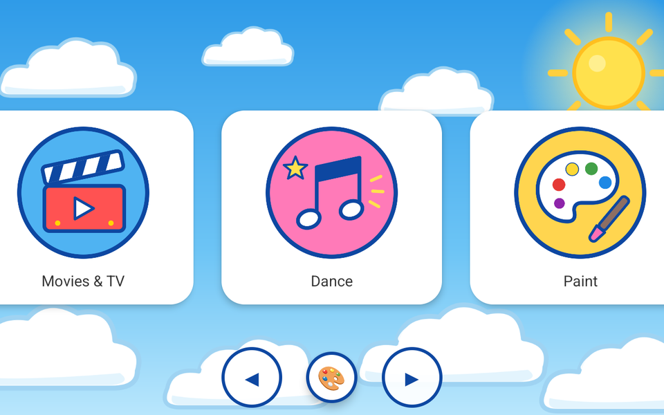
</p>

## What the kids get

| | |
| --- | --- |
| 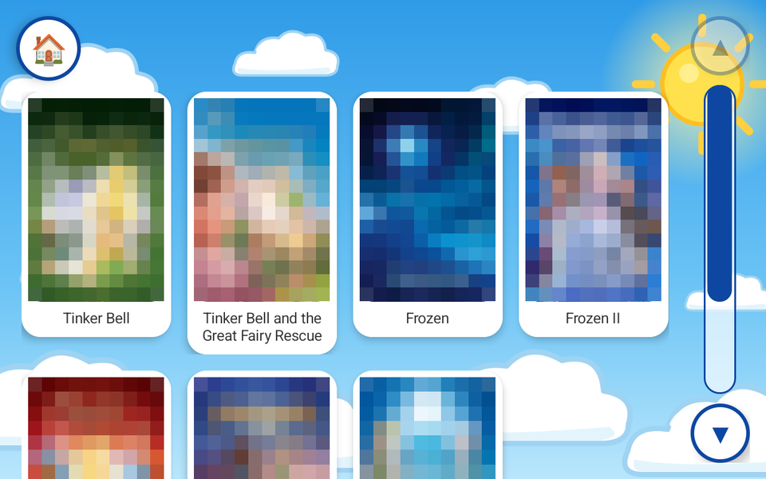 | 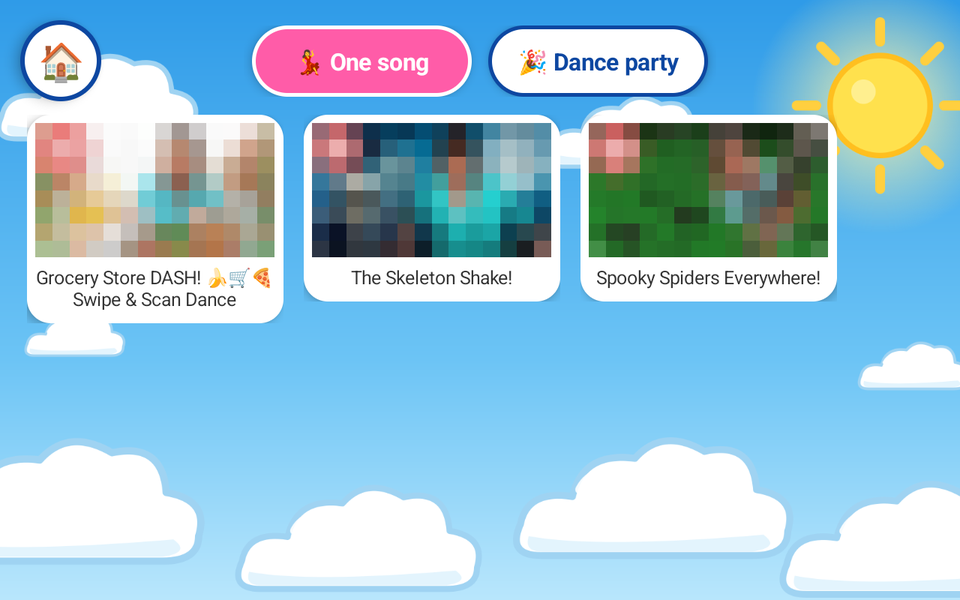 |
| **Movies & TV**: posters of the movies and shows a parent approved; a tap plays it on the TV (or on the tablet) | **Dance**: music videos the parents picked, one song or a "dance party" line-up |
| 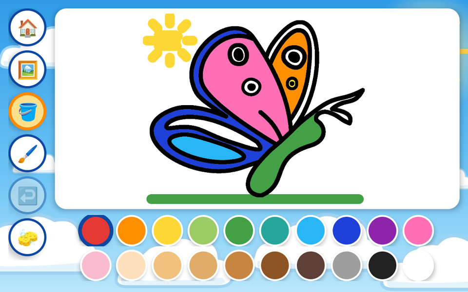 | 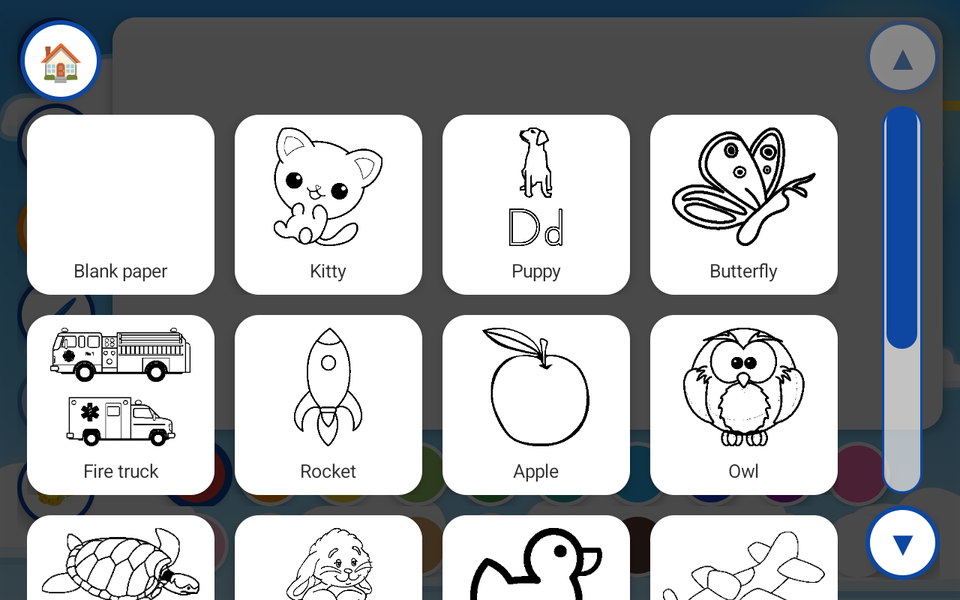 |
| **Paint**: tap to fill, or finger-paint with a fat brush; undo, and every page remembers the painting | **Coloring pages** the parents chose, plus blank paper |

- **Home screen**: a carousel of approved apps with big tiles (a pop and a
  bounce on every tap). Swipe it, or tap the big **◀ ▶ arrows**. The app used
  most recently comes first. Kids pick their own background theme from 10
  cartoon themes: sky, space, sea, dinosaurs, trucks, princess, unicorn, fairy
  garden, mermaid and sweets. A floating home button leaves any app.
- **Movies & TV**: a tap plays the title on the living-room TV, a **Roku** or an
  **LG webOS** TV.
  - Plex titles always start from the beginning, and shows go on to the next
    episode. On an LG, Plex plays over AirPlay.
  - Netflix titles open by deep link, and are rewound to the start on a Roku if
    Netflix resumes partway in.
  - The kid's **favorites** (picked twice or more in the last month) come first.
  - Netflix shows get proper portrait posters, from TVmaze.
- **Watching on the tablet**: while the parents have paused movie time (or there
  is no TV), picks play on the tablet itself.
  - Plex plays in Movies & TV's own simple player: big 🏠 and ⏸/▶, no seek bar.
  - Songs play in YouTube Kids behind a shield that swallows every tap, so the
    only way out is 🏠. When the song ends, the kid is back in Dance.
- **Even volume**: Plex is often far quieter than YouTube.
  - The box measures each Plex title's loudness (EBU R128) as it streams, and
    the tablet's player turns quiet titles up and loud ones down.
  - On an LG TV, it remembers a TV volume for each kind of video (Plex, Netflix,
    YouTube) and switches to it before the next pick.
- **Paint**: fill and brush tools, 20 colors (skin tones included), undo (wiping
  the page included), and blank paper or coloring pages. Pages are downloaded
  to the box once and turned into clean black lines, so fills stop at the edges
  and Paint works without the internet.
- **Toddler-proofing**:
  - A **big scroll bar** (▲, a draggable track, ▼) on every list, so scrolling
    never picks something by accident.
  - One pick per visit, and a 90 s lockout while the TV catches up.
  - Drags never turn into taps (touch debounce).
  - The screen fades to black after 10 idle minutes, and the touch that wakes it
    is swallowed.
  - No system bars, no rotation, no camera/phone/messages apps.
  - Family-filtered DNS.

<p align="center">
  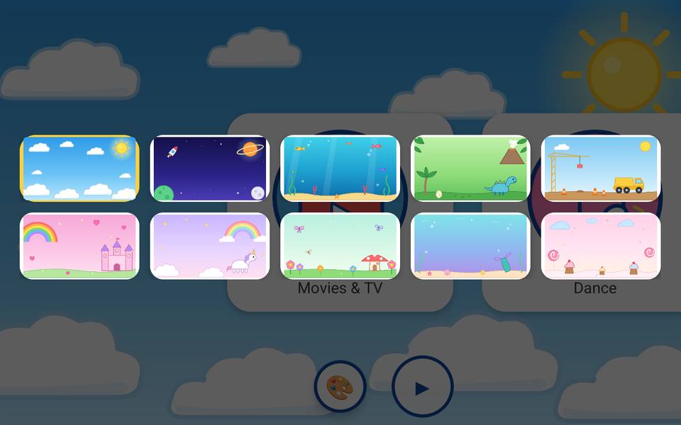
  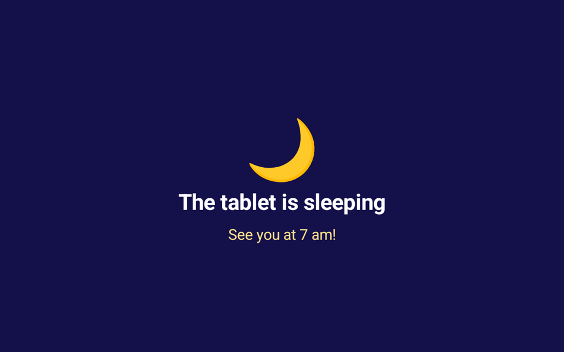
</p>

## What the parents get

| | | |
| --- | --- | --- |
| 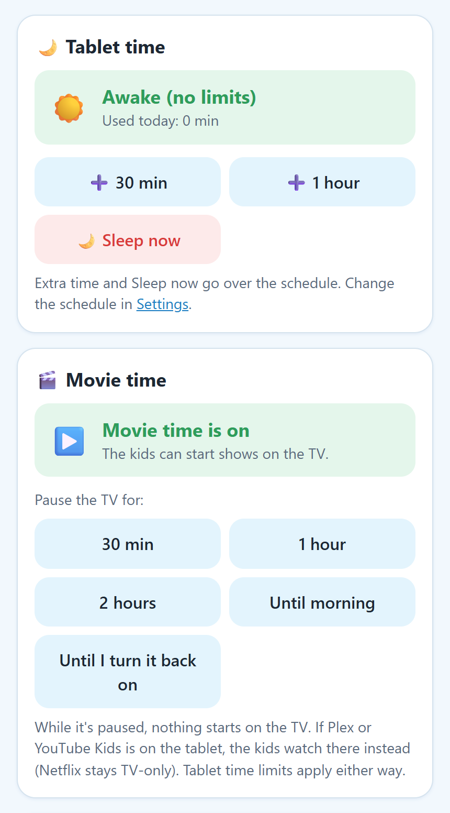 | 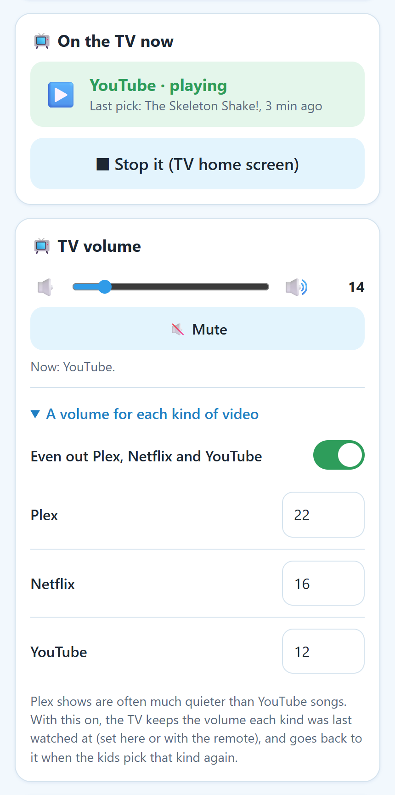 | 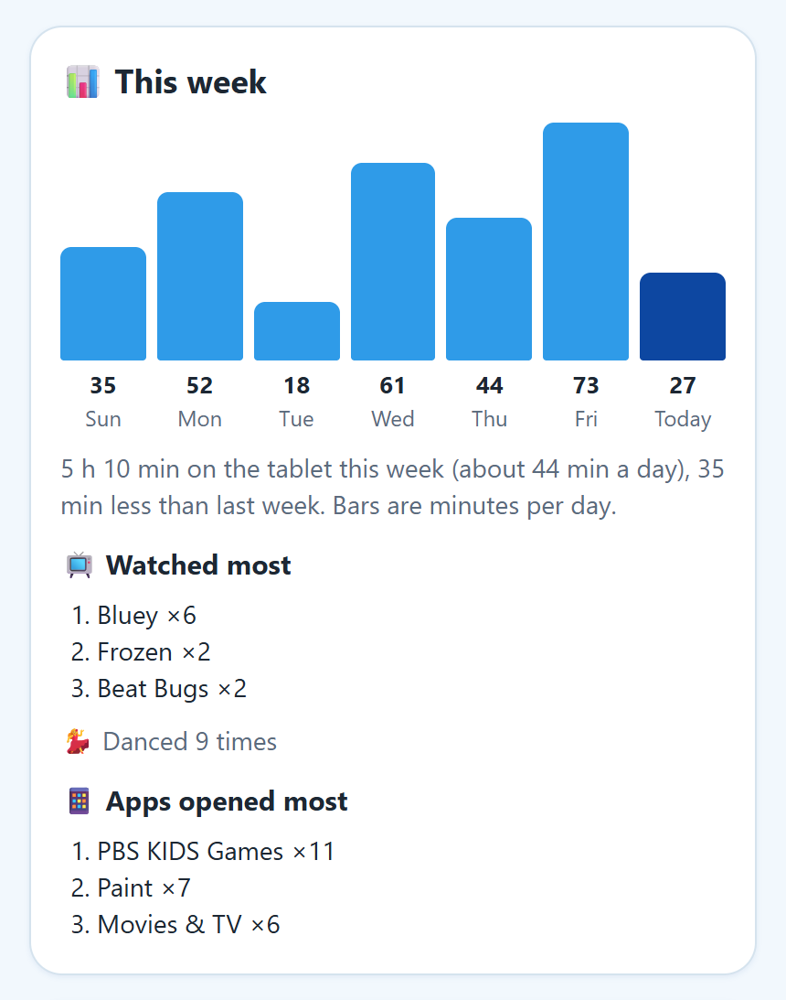 |
| Tablet time and movie time | The TV and its volume | This week |
| 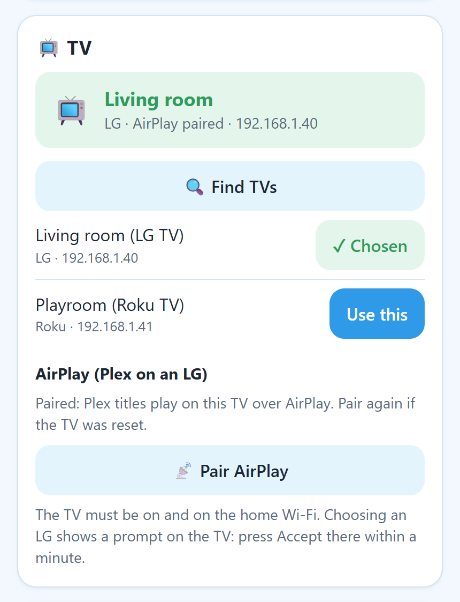 | 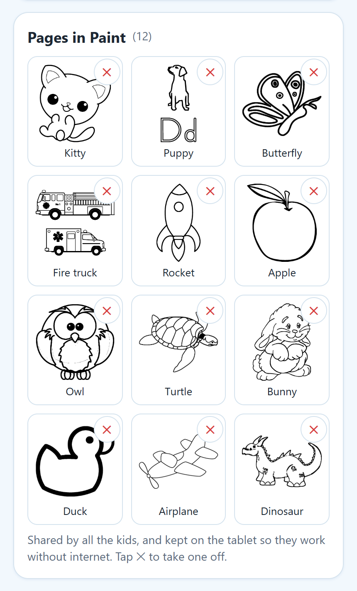 | |
| Choosing the TV | Coloring pages | |

- **Phone web page** at `http://<box>.local:8766/`. It's PIN-protected and only
  answers on the home network.
  - **Home**:
    - **Tablet time**: "+30 minutes" and "sleep now".
    - **Movie time**: pause the TV for a while, and the kids watch on the
      tablet instead.
    - **What's on the TV now**, with a Stop button.
    - **TV volume**: a slider and mute on an LG, louder/quieter/mute buttons on
      a Roku, plus the volume for each kind of video.
    - **Tablet volume**.
  - **Lists**, per kid for Movies & TV and Dance, plus the shared **coloring
    pages**. Pages come from a search of Crayola's free coloring pages, or any
    picture added by link or file upload (PNG, JPG, GIF, WebP, SVG).
  - **Activity**:
    - **This week**: minutes per day against last week, and what was watched
      and opened most.
    - **History** of what each kid played and opened.
    - Screen time counts only while the screen is awake and the kid is allowed
      on.
  - **Settings**:
    - The **schedule**: allowed hours and a daily limit.
    - **The TV**: find TVs on the network, choose one (an LG asks you to press
      Accept), and pair AirPlay with the PIN the TV shows.
    - A health card: TV, Plex, last update, disk, and the last automatic fix.
    - **Restart / shut down** the box.
- **Parent desktop** (GNOME, password-protected):
  - "Kid Tablet (parent mode)" to install and approve apps in a kid's Android.
  - A **Users** app: names, themes, add or remove kids, the parent password.
  - "Back to Kids OS".
- **Several kids**: each has their own Android (apps, sign-ins, progress), lists,
  schedule and theme. The login screen shows a picture of each kid to tap.
- **Hidden way out**: tap the four screen corners clockwise from top-left
  within 6 s (or hold Ctrl+Alt+Shift+P) to reach the login screen.
- **Self-repair and updates**:
  - If Android's video decoder hangs, the box restarts it, or Android, by
    itself.
  - On every boot the box pulls its branch of this repository and re-runs only
    the setup stages whose files changed.

*Screenshots come from the development VM. The usage numbers and the TVs are
sample data, and movie posters and video pictures are pixelated because the
artwork isn't ours to publish. The coloring pages shown are public domain
(Openclipart).*

## Hardware

- **A PC** that runs Ubuntu 24.04, with **Intel or AMD graphics**. Waydroid on
  NVIDIA falls back to slow software rendering. UEFI boot. Built and used on a Dell OptiPlex (i5-4570S, Intel HD 4600).
- **A touchscreen monitor** (USB HID). Built with a 1024x768 USB panel. Panels
  that report themselves as a pen are handled.
- **Optional, a TV on the same network** for Movies & TV and Dance:
  - **Roku**: Settings → System → Advanced system settings → Control by mobile apps
    → Network access: **Default**.
    In the Roku's Plex app, turn "Automatically sign in" off.
  - **LG webOS**: General → Devices → External Devices: "TV On With Mobile" /
    "LG Connect Apps" on. Plex plays over AirPlay, paired once from the web page.
- **Optional sources**: a Plex server, Netflix and
  YouTube on the TV, and the Plex and YouTube Kids Android apps for watching on
  the tablet.

## Installing

### 1. Ubuntu

Install **Ubuntu Server 24.04** (or Desktop) on the PC. Make the first user the
**parent** account, with a password; the setup adds the kid account itself.
Plug in the network cable (or join Wi-Fi), and boot in UEFI mode.

### 2. Kids OS

On the PC (or over SSH):

```bash
sudo apt-get install -y git
git clone https://github.com/toxiicxmonster/kids-os.git
sudo TABLET_REPO=https://github.com/toxiicxmonster/kids-os.git ./kids-os/setup/install.sh
```

This runs every setup stage in order and takes about an hour, mostly downloads.
It logs to `/var/log/tablet-os-setup.log`, and it's safe to run again: each
stage is idempotent. A single stage runs with `sudo ./kids-os/setup/install.sh 35`.

| Stage | What it does |
| --- | --- |
| 10 | Desktop (GNOME for the parent), NetworkManager, no release-upgrade prompts |
| 20 | Kid account, GDM login screen (timed login, kid pictures), the sky theme |
| 30 | Waydroid with Google apps, ARM translation (libndk), hardware or software rendering |
| 35 | Builds and installs the Android apps: Tablet Home (device owner), Movies & TV, Dance, Paint |
| 36 | The bridge (Movies & TV, Dance, the web page, schedules), ffmpeg, yt-dlp, AirPlay |
| 40 | The Cage kiosk session, touch panel fixes, sound at 100% |
| 50 | Lockdown (no VT switching, no power menu for kids), boot splash |
| 60 | The parent switch (corner taps), screen sleep |
| 70 | Family DNS (Cloudflare for Families), also for Android |
| 80 | Claude Code for the parent account |
| 90 | The updater (`tablet-update`, before the login screen at every boot) |

Settings, as environment variables before `install.sh`:

| Variable | Default | |
| --- | --- | --- |
| `PARENT_USER` | the user running sudo | the parent account |
| `KID_USER` | `kid` | the first kid's account |
| `FAMILY_DNS` | `1.1.1.3 1.0.0.3` | the filtered DNS servers |
| `WAYDROID_RENDER` | `auto` | `hardware` or `software`; auto picks software in a VM or on NVIDIA |
| `TABLET_REPO` | this repo over SSH | where updates come from; use the HTTPS URL unless you have a deploy key |
| `TABLET_BRANCH` | `stable` | the branch to follow (`main` is development) |

Reboot when it's done. The PC boots to the Kids OS splash and then the kid's
home screen.

### 3. First setup

1. **Google Play**: Waydroid isn't a certified device, so register it once. With
   the kid's home screen up, run `tablet-android-id` as the parent and enter the number at
   [google.com/android/uncertified](https://www.google.com/android/uncertified).
   Wait a few minutes before signing in.
2. **Parent mode**: tap the corners clockwise from top-left (or hold
   Ctrl+Alt+Shift+P) and log in as the parent. Open **Kid Tablet (parent
   mode)**. Sign in to the Play Store with an ordinary Google account (not a
   Family Link one), turn on Play parental controls, install apps (PBS KIDS
   Games, Khan Academy Kids, …), and switch on "In carousel" for the ones the
   kid should see.
3. **Movies & TV** (in parent mode): link Plex (a code for plex.tv/link) and
   pick the kid's profile. Set the **web page PIN** under "Phone & web control",
   or run `sudo -u tablet-movies tablet-movies-bridge --set-pin 1234`.
4. **The web page**: open `http://<box>.local:8766/` on your phone and enter the
   PIN.
   - In **Settings → TV**, find and choose the TV. An LG needs Accept pressed on
     the TV, then **Pair AirPlay** for Plex.
   - In **Lists**, add movies, shows, Netflix links, songs and coloring pages.
5. **More kids**: open the **Users** app on the parent desktop. Each new kid
   starts with a copy of the first kid's Android.
6. **Check it**: `sudo -u tablet-movies tablet-movies-bridge --check` runs every
   step of a TV play except the last command to the TV.

### Updates

`tablet-update` runs before the login screen at every boot (and by hand with
`sudo tablet-update`). It fetches `TABLET_BRANCH` and re-runs only the stages
whose files changed, retrying any that didn't finish. Its last result is in
`/var/lib/tablet-os/last-update` and on the web page.

### USB installer (cloning a box)

`tools/make-stick.ps1` (Windows, elevated) turns a USB stick into an "Install
Kids OS" stick. It holds Ubuntu's autoinstall, this setup, and a session
exported from an existing box with `tools/export-session.sh`, so the new box
starts with the same apps and sign-ins. First boot finishes the setup by
itself.

## Layout

| Path | What |
| --- | --- |
| `setup/install.sh`, `setup/stages/NN-*.sh` | the setup, in stages |
| `setup/files/` | everything the stages install: kiosk session, bridge, web page, helpers, themes, boot splash |
| `setup/android/` | the four Android apps (Tablet Home, Movies & TV, Dance, Paint), built with the bare SDK tools, no Gradle |
| `installer/` | autoinstall config for the USB installer |
| `tools/` | USB stick builder, session export, the bridge stress test |
| `docs/screenshots/` | the pictures in this README |

See `CLAUDE.md` for how it fits together and the hard-won details.

## License

MIT, see `LICENSE`.

## Not affiliated

Not affiliated with or endorsed by Plex, Netflix, YouTube, Roku, LG, Apple, PBS
KIDS, Danny Go!, Crayola, TVmaze or Openclipart.
- **Nothing is downloaded** from YouTube or Netflix: titles play in the TV's own
  apps, or in YouTube Kids on the tablet.
- **Plex** streams come from your own server.
- **Crayola's coloring pages** are free for personal use. Each box downloads
  only the ones its parents pick, for its own kids, and none are included in
  this repository.
