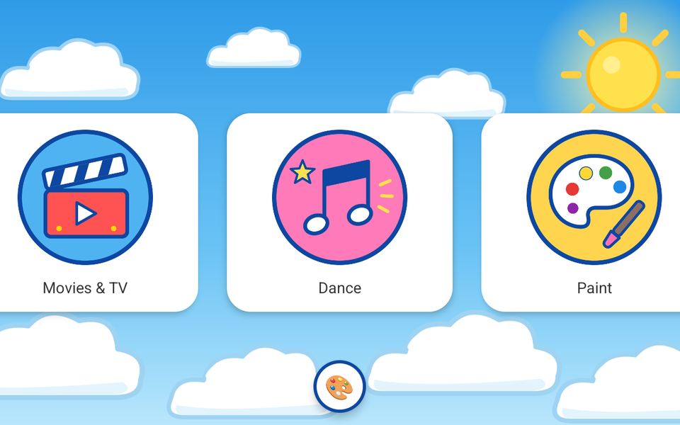
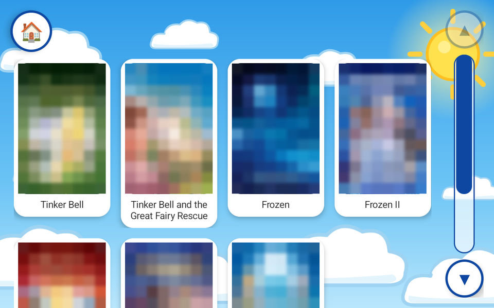
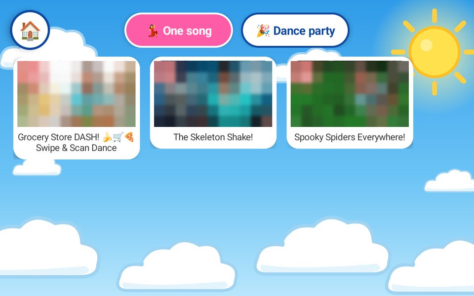
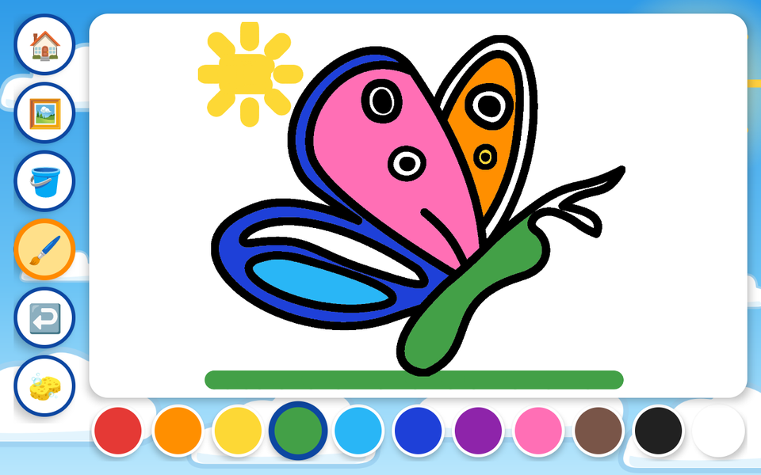
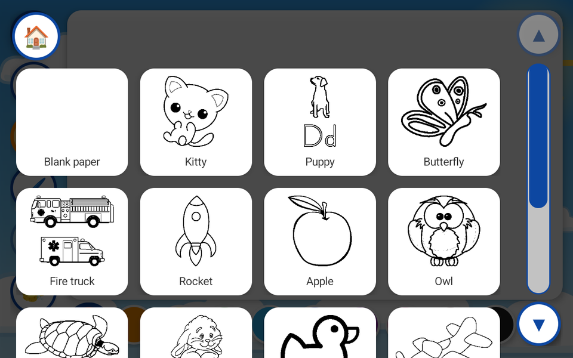
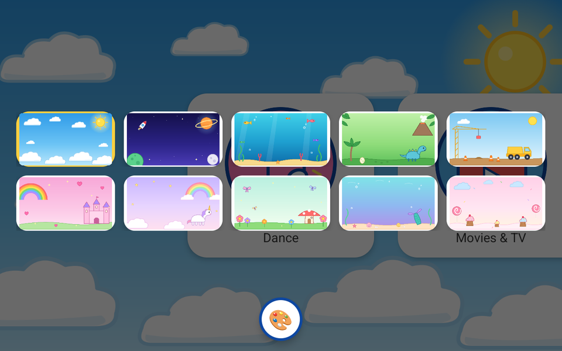
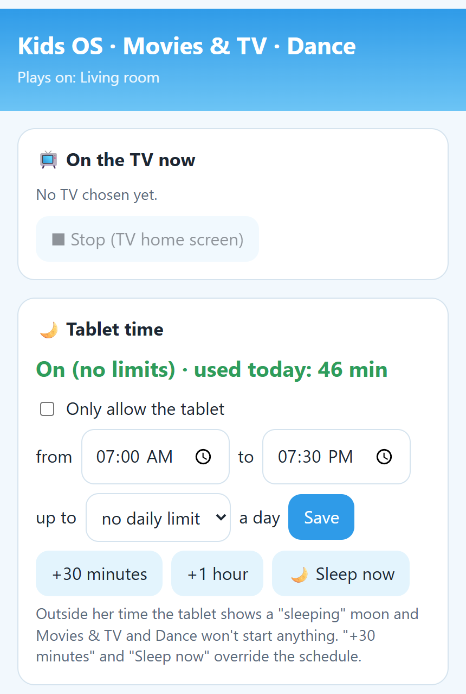
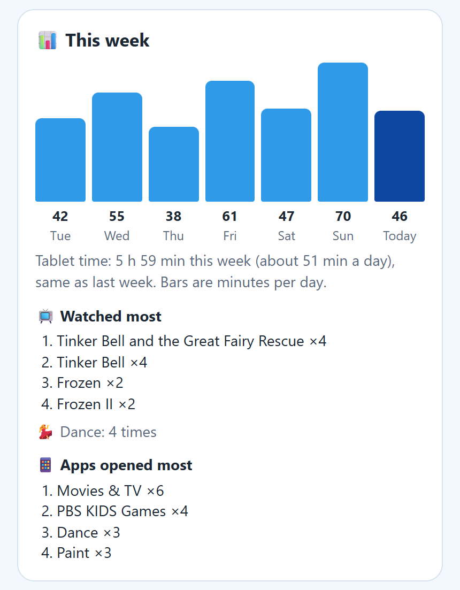
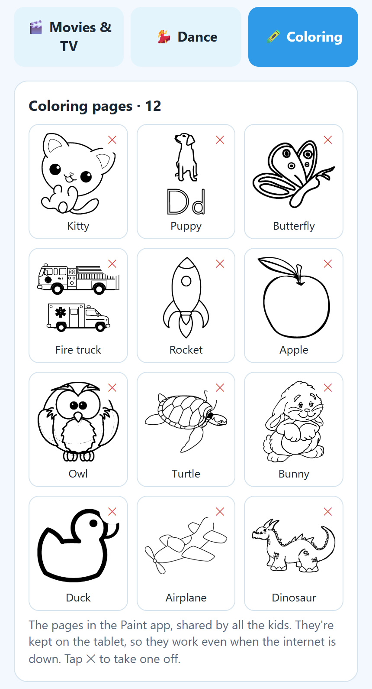

# Kids OS

A toddler-proof tablet built from an old PC and a touchscreen monitor. Kids get
a big, simple Android home screen with only the apps a parent picked; parents
get a normal Ubuntu desktop, a Users app, and a web page on their phone.

It runs **Ubuntu 24.04** with **Waydroid** (LineageOS 20 / Android 13 with Google
apps) full-screen in a **Cage** kiosk session. Each kid logs in with a tap and
lands straight in their own Android; nothing else on the PC is reachable.

  

## What the kids get

| | |
| --- | --- |
|  |  |
| **Movies & TV**: posters of the movies and shows a parent approved; a tap plays it on the TV | **Dance**: music videos on the TV, one song or a "dance party" line-up |
|  |  |
| **Paint**: tap to fill, or finger-paint with a fat brush; undo, and every page remembers the painting | **Coloring pages** the parents chose, plus blank paper |

- **Home screen**: a swipeable carousel of approved apps (big tiles, a pop and a
  bounce on every tap), with **the app used most recently first**, a background
  theme the kid picks themselves (10 cartoon themes: sky, space, sea, dinosaurs,
  trucks, princess, unicorn, fairy garden, mermaid, sweets), and a floating home
  button to leave any app.
- **Movies & TV**: a tap plays it on the living-room **Roku TV**: Plex titles
  always from the beginning (shows pick a random episode), Netflix titles by deep
  link, rewound to the start if Netflix resumes partway in. The kid's
  **favorites** (picked twice or more in the last month) come first, and Netflix
  shows get proper portrait posters (from TVmaze).
- **Dance**: YouTube music videos the parents picked (e.g. Danny Go!) on the TV,
  without anyone hunting with the remote.
- **Paint**: fill and brush tools, 20 colors (skin tones included), undo (wiping the page included)
  and blank paper or coloring pages. Pages are downloaded to the box once and
  turned into clean black lines, so fills stop at the edges and it all works
  without the internet.
- **Toddler-proofing**: a **big scroll bar** (▲, a draggable track, ▼) on every
  list so scrolling never picks something by accident, one pick per visit and a
  90 s lockout while the TV catches up, drags that never turn into taps (touch
  debounce), the screen fades to black after 10 idle minutes (the waking touch
  is swallowed), no system bars, no rotation, no camera/phone/messages apps,
  family-filtered DNS.

  

## What the parents get

| | | |
| --- | --- | --- |
|  |  |  |
| Tablet time and the TV | This week | Coloring pages |

- **Phone web page** (`http://<box>.local:8766/`, PIN-protected, home network
  only):
  - per-kid lists for Movies & TV and Dance, and the shared **coloring pages**:
    search Crayola's free coloring pages, or add any picture by link or file
    upload (PNG, JPG, GIF, WebP, SVG)
  - **tablet time**: allowed hours, daily limit, "+30 minutes", "sleep now"
  - **this week**: minutes per day against last week, what was watched and
    opened most
  - what's on the TV now with a Stop button, history of what each kid played and
    opened, pause movie time, tablet volume, and a health/status card
- **Parent desktop** (GNOME, password-protected): "Kid Tablet (parent mode)" to
  install and approve apps in a kid's Android, a **Users** app (names, themes,
  add/remove kids, parent password) and "Back to Kids OS".
- **Hidden way out**: tap the four screen corners clockwise from top-left
  within 6 s (or hold Ctrl+Alt+Shift+P) to reach the login screen.
- **Updates**: on every boot the box pulls its branch of this repository and
  re-runs only the setup stages whose files changed.

*Screenshots come from the development VM. The usage numbers are sample data,
and movie posters and video pictures are pixelated because the artwork isn't
ours to publish. The coloring pages shown are public domain (Openclipart).*

## Hardware

Anything that runs Ubuntu 24.04 with **Intel or AMD graphics** (Waydroid on
NVIDIA falls back to slow software rendering) and a touchscreen monitor. Built
and used on a Dell OptiPlex (i5-4570S, HD 4600) with a 1024x768 USB touch panel.
A Roku TV on the same network is needed for Movies & TV and Dance; Plex and
Netflix are optional sources.

## Installing

1. Install Ubuntu Server 24.04 (or use the USB installer, below).
2. Copy `setup/` to the machine and run `sudo ./setup/install.sh` (stages 10-90,
   about an hour, mostly downloads). Environment knobs: `PARENT_USER`,
   `KID_USER`, `FAMILY_DNS`, `WAYDROID_RENDER=software|hardware`.
3. Sign in to Google once in parent mode (use an ordinary account, not a Family
   Link one), approve apps, link Plex and pick the TV in Movies & TV setup, and
   set the web page PIN.

**USB installer**: `tools/make-stick.ps1` turns a USB stick into an "Install
Kids OS" stick (Ubuntu's autoinstall plus this setup). Optionally it carries a
session exported from another Kids OS box (`tools/export-session.sh`) so the new
box starts with the same apps and sign-ins.

**Updates from your own fork**: stage 90 points `tablet-update` at
`TABLET_REPO` / `TABLET_BRANCH` (SSH with a read-only deploy key, so private
forks work).

## Layout

| Path | What |
| --- | --- |
| `setup/install.sh`, `setup/stages/NN-*.sh` | the setup, in stages (desktop, accounts, Waydroid, apps, Movies & TV, kiosk, lockdown, parent switch, DNS, Claude Code, updater) |
| `setup/files/` | everything the stages install: kiosk session, bridge, web page, helpers, themes, boot splash |
| `setup/android/` | the four Android apps (Tablet Home, Movies & TV, Dance, Paint), built with the bare SDK tools, no Gradle |
| `installer/` | autoinstall config for the USB installer |
| `tools/` | USB stick builder, session export |
| `docs/screenshots/` | the pictures in this README |

See `CLAUDE.md` for how it fits together and the hard-won details.

## Not affiliated

Not affiliated with or endorsed by Plex, Netflix, YouTube, Roku, PBS KIDS, Danny
Go!, Crayola, TVmaze or Openclipart. Nothing is downloaded from YouTube or
Netflix: titles play in the TV's own apps. Crayola's coloring pages are free for
personal use: each box downloads the ones its parents pick for its own kids, and
none are included in this repository.
